# Reuse Store Benchmark: Results and Next Tests

**Kept in two places, identical below this header:** linux `ubuntu/26.04/05-llm-local/reuse-store-benchmark.md` and sound-design `enforcement/languages/bechmarking/reuse-store-benchmark.md`. Change both together.

---

**Updated:** 2026-11-13 (harness changes P1–P4 and task set B; the two uses of the SQLite store; corrections to the 32k limit and the 64k failure).

## Two uses of the SQLite store

The SQLite store serves two separate uses. Each use stores different data, works by a different mechanism, and has its own benchmark and results. The table compares them.

| | 1. Speed and token reduction | 2. Out-of-memory mitigation |
|---|---|---|
| **Problem** | Work recurs across sessions, agents, and stewards. Each time, the model reads the same files again and derives the same answers again, spending tokens and time. | A run that keeps its settings (model, context, micro-batch, KV cache type, layers on the GPU) runs out of GPU memory while it computes a long context. |
| **What the store holds** | What the model derived, as text: answers and summaries, keyed by the question and by the files they came from. | What the model computed, as tensors: the KV cache after a long context is processed (the depth state), keyed by model file, depth, and K and V cache types. |
| **How it helps** | The harness gives the model stored entries instead of file reads. Prompts are shorter, turns fewer, and generated tokens fewer. | llama-bench copies the stored KV cache into the GPU memory reserved at startup. The computation that runs out of memory never runs. |
| **What it does not change** | The GPU memory reserved at startup, which the context size sets when the server starts. | The number of tokens in the context (65,536) and the memory reserved at startup. The store removes a computation, not tokens. |
| **Benchmark** | The `reuse` suite of `01-bench-llama-cpp.swift`, through llama-server with file tools; this document, sections 1–3. | `llama-bench` with the `--store` option ([`llama-bench-sqlite-store.patch`](llama-bench-sqlite-store.patch)); [`llama-bench-oom-reuse-sqlite.md`](llama-bench-oom-reuse-sqlite.md). |
| **Measured result** | Qwen3.8-27B, 13 repeated questions, 32k context: 73% fewer prompt tokens computed, 58% fewer generated, 64% less wall time, 70% lower largest peak context, 13/13 correct (section 2). | Gemma 4 31B, depth 65,280, 65,536-token context: the run that failed finishes at 20.09 ± 0.27 t/s with the store and CUDA graphs off. Without the store it fails, with graphs on or off. |
| **Limits** | Repeated questions only; one run per mode; no context pressure. | One run per configuration; CUDA graphs must also be off, to remove a second out-of-memory error; the time saved by skipping the depth was not measured separately. |

The two uses do not substitute for each other:

- **Use 1 keeps the startup reservation.** It cannot stop a failure that comes from the memory a context reserves at startup. It could avoid one only indirectly: if a smaller peak lets the work run at a smaller context. That route is untested. In Test 1's runs, the model read the files even with stored entries offered, so the peak did not fall.
- **Use 2 keeps the token count.** It does not shorten prompts or reduce the tokens a model reads. It removes the computation of tokens already processed once, which also saves the time that computation takes.

## Why this benchmark exists

**It started with a failure.** On 2026-11-12, `01-bench-llama-cpp.swift run gemma-4-31b depth` measured Gemma 4 31B on the 24 GB RTX PRO 5000 laptop GPU. It ran at 27.6 tokens/s with empty context and 22.7 at 32k. At depth 65,536 (a 66,048-token context) it ran out of GPU memory: the 16.4 GiB of weights, plus a full-precision (f16) KV cache sized for that context, plus compute buffers, didn't fit, and the last allocation came up at least 620 MiB short. The model fit; the context didn't.

**Correction (2026-11-13):** that failure belongs to llama-bench's settings, not to the model on this GPU. llama-server runs Gemma 4 31B at a 65,536-token context, because it reserves 386 MiB less at startup than llama-bench (output for one token instead of up to 512). The 32k limit stated in this section and in the prediction that follows is wrong. The lldb trace in [`llama-bench-oom-gemma-4-31b.md`](llama-bench-oom-gemma-4-31b.md) and [`llama-bench-oom-reuse-sqlite.md`](llama-bench-oom-reuse-sqlite.md) gives the measured limits.

**The theory** (sound-design `burst-buffer/data-storage/llm-reuse-store.md`): the LLM stores what doesn't need recomputing in an external database (SQLite), so it spends fewer tokens. It's a theory of **deeper reuse**, originated by the user. It goes beyond the two layers LLM work already reuses:
- instructions kept in files (CLAUDE.md, agent and persona files), which carry guidance written once;
- the KV cache in use (llama.cpp's prompt cache, frontier prompt caching), which avoids recomputing an identical prompt prefix within one server.

The store holds what the model derives while working, keyed by the files it came from, across sessions, models and hosts. The user's earlier test, several days before this benchmark, proved the theory valid. This benchmark gives concrete, measured proof of it on local models and this hardware, and takes it to the out-of-memory case.

Applied to the failure:
- An agent fills its context mostly by re-reading material: source files, documents, its own earlier analysis. If that arrives as stored summaries and answers instead, with only the files being changed read in full, a task that needed about 64k tokens would need about 10–20k (an estimate, assuming 5–15× compression of reference material).
- That fits inside the 32k Gemma 4 31B was then believed to handle, so the out-of-memory failure would not occur. (Corrected 2026-11-13: llama-server runs the model at 65,536; see the correction in this section.)
- Other expected benefits:
  - faster cold prompts on the dense models (estimated 4–6×, from the measured prompt rates);
  - fewer tokens spent on frontier models;
  - work done by one model or steward becoming reusable by another.

**Why a new benchmark was needed:** `llama-bench` can't test any of this. It fills context with synthetic tokens and runs no task, so there is nothing to store and nothing to reuse. Testing the theory needs real tasks, run through a model that can read files and a store, with and without the store. That is the `reuse` suite of `01-bench-llama-cpp.swift`, run on task set `reuse-tasks-c++.json`: 13 questions about the sound-design C++ enforcement profile, each scored by required facts.

### The prediction under test

Made on 2026-11-12, before any reuse run. The benchmark figures are measured; everything under "with the store" is an estimate.

| | Without the store | With the store (estimate) |
|---|---|---|
| Context for a task that now needs ~64k | ~64k tokens | ~10–20k: about 5–15× compression of the reference material, plus the files being edited in full |
| Gemma 4 31B on 24 GB, f16 KV cache | **Fails** (out of memory) | **Fits**: 32k is measured to work |
| Cold prompt time, Gemma 4 31B | Not possible at 64k; about 40 s at 32k | About 7–15 s, from the measured 1,117–1,240 t/s at 0–8k |
| Cold prompt time, Qwen3.8-27B (64k works) | About 65 s | About 10–15 s |
| Generation speed, Gemma 4 31B | 22.7 t/s at 32k | About 25–27 t/s (measured 25.0 at 8k, 27.6 empty) |

Limits stated with the prediction:
- **The compression ratio is the unknown that matters.** 5–15× is an assumption for summaries against raw files. The store's own token accounting would measure it.
- **The first pass pays full price.** Material never summarized costs its full tokens once; the saving comes on reuse.
- **Exact work needs exact text.** Editing or debugging a specific function needs that function verbatim, so the floor is the code under change, not zero.
- **llama-bench contexts are synthetic.** It fills depth with filler tokens, so the table extrapolates to real tasks; it was not measured on them.

**Correction (2026-11-13):** the table's 64k rows describe llama-bench, not llama-server. "Fails (out of memory)" and "Not possible at 64k" do not hold for llama-server: on 2026-11-13 it ran Gemma 4 31B on task set C at a 65,536-token context for 840 s, until the context filled, with no out-of-memory error. llama-bench itself fails at a 65,536-token context on its first batch, before any depth is processed.

The direct test proposed then is still the one that matters: the same task run with and without the store, comparing peak context, prompt time and whether it fits.

### The question now

Case 1 (repeated work) validated the benefits of reuse: 73% fewer prompt tokens computed, 58% fewer generated, 64% less wall time and a 70% lower peak context, with correctness unchanged. **The next question is whether those benefits positively impact the out-of-memory scenario.** Test 1 (section 3) answers it, as case 3. Its tasks need more than the 32k context Gemma 4 31B can hold; the store is built by other work over the same material; and runs with and without that store measure each benefit at the limit: fitting the context, a smaller context, less computation, lower latency, cross-model reuse and correctness.

### Three cases of reuse

| Case | What recurs | Status |
|---|---|---|
| **1. Repeated work** | The same questions over unchanged files, as work recurs across sessions, agents and stewards | **Measured** (2026-11-13): summary below, details in section 2 |
| **2. Different questions over the same material** | Other questions whose answers draw on what earlier work read | Designed, ready to run: Test 2, task set B |
| **3. Work that exceeds the context** | A workload too large for the model's context without the store: the out-of-memory failure | **Ready:** Test 1, task set C and harness additions done |

Each case measures the same benefits: fitting the context, a smaller context, less computation, lower latency, correctness held, and the cost of building the store against its saving.

## The workflow so far

```mermaid
flowchart TD
    A["Gemma 4 31B runs out of GPU memory at 64k context<br/>(llama-bench depth suite, 2026-11-12)"]
    B["Theory: the LLM stores what doesn't need recomputing in SQLite<br/>→ fewer tokens → smaller context → the workload fits"]
    C{"Can llama-bench test it?"}
    D["Build the reuse suite: 13 C++ profile tasks, file tools,<br/>a SQLite store, scoring by required facts"]
    E["Smoke test on gpt-oss-20b: the model ignored the store tools<br/>→ the harness looks up before compute and stores answers itself"]
    F["Runs 1 and 2 on Qwen3.8-27B: baseline, cold store, warm store"]
    G{"Review: the cold column is far too large for the work done"}
    H["Defect found: unstable JSON key order in the harness<br/>→ 0–2% prompt-cache reuse; runs 1 and 2 invalid for cost"]
    I["Fix: sorted keys, reasoning returned with each turn<br/>verified at 54–69% cache reuse"]
    J["Run 3: first valid results — case 1, repeated work (summary below)"]
    K["Harness changes P1–P4 and task set B"]
    L["Test 1, case 3: work that exceeds the context — does reuse prevent the out-of-memory failure?<br/>and the other benefits; Gemma 4 31B and Qwen3.8-27B at 32k; task set C"]
    L2["Test 2, case 2: different questions over the same material<br/>task set B against set A's store"]
    M["Test 3: invalidation — no stale entry is served"]
    N["Test 4: a cheap model reusing a strong model's work"]
    O["Test 5: what is worth storing"]
    A --> B --> C
    C -- "No: synthetic tokens, no tasks to reuse" --> D
    D --> E --> F --> G --> H --> I --> J --> K --> L --> L2 --> M --> N --> O
    classDef done fill:#d8f0d8,stroke:#3a7a3a,color:#000
    classDef next fill:#fff1c2,stroke:#a07800,color:#000
    classDef planned fill:#eeeeee,stroke:#777777,color:#000
    class A,B,C,D,E,F,G,H,I,J,K done
    class L next
    class L2,M,N,O planned
```



Green is done, yellow is next, grey is planned.

## Summary: case 1, repeated work (first valid run, 2026-11-13)

This run measures case 1: the same 13 questions asked again over unchanged files, as happens when work recurs across sessions, agents and stewards. The results are valid as measured. Cases 2 and 3, including the out-of-memory failure that started this, are Tests 2 and 1 (section 3).

Qwen3.8-27B answered 13 questions about the C++ profile, at 32k context.

| | Baseline | Store, cold | Store, warm |
|---|---:|---:|---:|
| Correct | 13/13 | 13/13 | 13/13 |
| Turns | 48 | 72 | 13 |
| Prompt tokens computed | 74,699 | 93,886 (+26%) | 20,473 (−73%) |
| Prompt cache reuse | 61% | 79% | 36% |
| Generated tokens | 10,122 | 18,099 (+79%) | 4,298 (−58%) |
| Wall time | 560 s | 1,083 s (+93%) | 200 s (−64%) |
| Largest peak context | 11,536 | 14,930 (+29%) | 3,432 (−70%) |
| Average peak context | 7,035 | 9,494 (+35%) | 2,790 (−60%) |
| Answered from the store alone | — | 0/13 | 13/13 |

1. **Reusing repeated work pays off heavily, with no loss of correctness.** Every warm task was answered from stored entries without reading a file.
2. **The store's cost is the model writing entries, not reading them.** Cold computed only 26% more prompt tokens, but generated 79% more and took 93% longer. On this dense model, generating a token is roughly 50 times slower than processing one.
3. **Break-even:** in tokens, after one reuse (cold plus one warm pass is 23% cheaper than two baselines). In time, after two reuses (cold plus two warm passes is 12% faster than three baselines).
4. **Toward the original question:** the warm store cut the largest peak context by 70% (11,536 to 3,432 tokens), the effect the theory relies on. Whether the store keeps a workload inside a context it would otherwise exceed is Test 1.
5. **Scope:** case 1 is repeated questions. Different questions (case 2) and work that exceeds the context (case 3) are Tests 2 and 1.

### Where the results are

- **This document**, in both repositories: section 2 has per-task figures, findings and limits; section 3 has the next tests.
- **Raw output** in `~/.local/share/llama-bench/`. Each run has a Markdown report (`.md`), per-task data with the answers and the entries served (`.jsonl`), GPU samples (`-gpu.csv`) and the server log (`-server.log`):
  - baseline: `2026-11-12T235300Z-qwen3.8-27b-reuse-baseline-ctx32768.*`
  - cold store: `2026-11-13T000255Z-qwen3.8-27b-reuse-store-ctx32768.*`
  - warm store: `2026-11-13T002251Z-qwen3.8-27b-reuse-store-ctx32768.*`
- **The store** used by the cold and warm runs: `~/.local/share/llm-reuse/c++-3.sqlite`, 39 entries. 13 of them are duplicates stored by the warm run, before the P1 fix.

## Early findings: smoke tests on gpt-oss-20b (2026-11-12 and 2026-11-13)

Two- and three-task runs used to bring the harness up. They're too small for cost conclusions, but each shaped the design:

1. **The model ignored the store tools.** gpt-oss-20b made no `store_search`, `store_lookup` or `store_put` call in either store run, so the store stayed empty. That's why the harness, not the model, now looks the question up before the model starts and stores each answer.
2. **Handed valid entries, it still re-read the files, and cost more than baseline.** With entries placed in its prompt for the exact question, it computed 5,173 tokens against 1,604 baseline (gate-flags) and 61,857 against 30,869 (two-layer-defense). It used the entries only once the prompt told it to answer from them when they suffice. After that, exact reuse saved work: 1,120 tokens against 1,615.
3. **Identical runs varied widely.** two-layer-defense's baseline computed 30,869 tokens in one run and 16,281 in the next. Part of that was the then-undetected prompt-cache defect. It's why `--repeat` exists and every test now runs 3 passes.
4. **Reuse spreads errors as well as answers.** In the P1–P4 smoke test, gpt-oss-20b answered iostream-example incorrectly in the cold pass, the answer was stored, and the warm pass reused the wrong answer. Unverified entries are observations, not facts. This is what Test 3 (one model reusing another's entries) has to measure, and why verified entries should rank above unverified ones.

## 1. How the suite works

- The script starts its own `llama-server` as the user on 127.0.0.1:9940, at a fixed context (`--ctx`, default 32768), with 1 slot.
- The model answers each task through read-only file tools: `list_files`, `read_file` and `grep`.
- With `--store <file>`, it also gets `store_search`, `store_lookup` and `store_put` over a user-owned SQLite file:
  - entries are append-only (triggers refuse `UPDATE` and `DELETE`);
  - search is FTS5;
  - an entry is valid only while the SHA-256 of every file it derives from matches.
- **The harness does the lookup and the storing**, so they don't depend on the model's cooperation (gpt-oss-20b ignored the store tools entirely in early tests). Before the model starts, the harness searches the store with the question and puts valid entries in front of it. After the answer, the harness stores it, depending on every file read or matched and every entry reused.
- Per task, the suite records:
  - outcome and correctness;
  - peak context;
  - prompt tokens sent, and prompt tokens computed (the rest came from llama-server's prompt cache);
  - prompt, generation and wall time;
  - tool calls;
  - harness hits, model hits and puts, and whether the answer was stored.

## 2. Results (2026-11-13, first valid run)

Qwen3.8-27B (UD-Q4_K_M), 32k context, f16 KV cache, 1 slot, llama.cpp `cd959ba`, source at sound-design `c3ef5c7`, harness at linux `be578a6`. One run per mode, in order:
1. **Baseline:** no store.
2. **Cold:** a fresh store (`c++-3.sqlite`), which fills.
3. **Warm:** the same store, now with 26 entries.

Two earlier runs on 2026-11-12 are invalid for cost because of a harness defect; see the end of this section.

### Totals

Percentages are the change from baseline.

| | Baseline | Store, cold | Store, warm |
|---|---:|---:|---:|
| Correct | 13/13 | 13/13 | 13/13 |
| Turns | 48 | 72 | 13 |
| Prompt tokens computed | 74,699 | 93,886 (+26%) | **20,473 (−73%)** |
| Prompt cache reuse | 61% | 79% | 36% |
| Generated tokens | 10,122 | 18,099 (+79%) | **4,298 (−58%)** |
| Wall time | 560 s | 1,083 s (+93%) | **200 s (−64%)** |
| Largest peak context | 11,536 | 14,930 (+29%) | **3,432 (−70%)** |
| Average peak context | 7,035 | 9,494 (+35%) | **2,790 (−60%)** |
| Answered from the store alone | — | 0/13 | **13/13** |
| Store: harness hits, model hits / puts | — | 56, 69 / 13 | 65, 0 / 0 |
| Store entries after | — | 26 | 39 |

The warm run's cache reuse is low because each warm task is a single turn: only the shared system prompt and tool definitions can come from cache.

### Per task (prompt tokens computed / wall seconds / peak context / cache reuse)

| Task | Baseline | Cold | Warm |
|---|---|---|---|
| gate-flags | 3,978 / 23 / 4,473 / 54% | 5,849 / 37 / 6,608 / 74% | 2,503 / 13 / 2,731 / 0% |
| verified-base | 7,589 / 28 / 8,669 / 55% | 10,662 / 55 / 12,689 / 73% | 1,174 / 12 / 2,402 / 45% |
| lint-layer-example | 6,586 / 22 / 7,521 / 56% | 8,375 / 53 / 10,394 / 75% | 1,354 / 10 / 2,529 / 41% |
| naming-cases | 8,088 / 31 / 9,214 / 39% | 6,852 / 104 / 9,302 / 86% | 1,414 / 12 / 2,627 / 40% |
| banned-queries | 6,102 / 52 / 7,774 / 59% | 7,891 / 71 / 10,324 / 76% | 1,389 / 15 / 2,682 / 41% |
| edict-check | 8,488 / 91 / 11,041 / 67% | 11,036 / 189 / 14,930 / 85% | 1,882 / 19 / 3,261 / 34% |
| provision-stages | 3,685 / 22 / 4,666 / 58% | 3,742 / 67 / 5,641 / 78% | 1,184 / 14 / 2,435 / 45% |
| format-string-ascii | 1,482 / 29 / 2,689 / 60% | 4,629 / 55 / 6,775 / 75% | 1,494 / 15 / 2,775 / 39% |
| two-layer-defense | 7,405 / 65 / 8,949 / 66% | 11,515 / 135 / 14,428 / 78% | 1,389 / 15 / 2,662 / 41% |
| build-variants | 3,388 / 54 / 4,822 / 42% | 5,457 / 103 / 8,057 / 79% | 1,891 / 26 / 3,432 / 34% |
| qa-engineer | 5,931 / 32 / 7,119 / 64% | 8,913 / 64 / 10,942 / 80% | 1,535 / 12 / 2,739 / 38% |
| ownership | 1,726 / 32 / 2,985 / 76% | 4,904 / 69 / 6,929 / 80% | 1,773 / 14 / 3,015 / 35% |
| macros | 10,251 / 78 / 11,536 / 69% | 4,061 / 80 / 6,403 / 82% | 1,491 / 23 / 2,977 / 39% |

### Findings

1. **Reuse of repeated work is large, and correctness held.** Every warm task was answered from the entries the harness supplied, with no file reads and no model store calls. Against the baseline: 73% fewer prompt tokens computed, 58% fewer generated, 64% less wall time, and a 70% lower peak context.
2. **The store's cost is the model writing, not reading.** Cold computed only 26% more prompt tokens than baseline, but generated 79% more (mostly the model's own 13 entries) and took 93% longer. On this dense 27B model, generating a token is roughly 50 times slower than processing one (about 25 against 1,200 tokens/s), so a write-heavy pass costs time far beyond its token count.
3. **Break-even comes after one reuse in tokens and after two in time.**
   - Tokens: cold plus one warm pass computes 23% less than two baselines; cold plus two, 40% less than three.
   - Wall time: cold plus one warm pass takes 15% longer than two baselines; cold plus two takes 12% less than three.

### Limits of this run

- **Scope: repeated questions (case 1).** Answers are stored keyed by the question, so the warm pass reuses whole answers. The only evidence for case 2, different questions, is the cold pass, where entries were offered (56 harness hits, 69 model hits) but every task still read files.
- **One run per mode.** Variance between identical runs has not been measured with a working cache.
- **No context pressure.** Peaks stayed under 15k on a 32k context, so this task set can't test whether the store keeps a workload inside a context it would otherwise exceed (the Gemma 4 31B case at 64k, which llama-bench fails with an out-of-memory error).
- **Duplicate entries.** The warm run stored every answer again, so the store grew from 26 to 39 entries with duplicates.

### Measurement defect: the prompt cache was not reused

Found after the first run on 2026-11-12, prompted by its cold column being unusually large for the work done. **The cost figures of both 2026-11-12 runs are not valid; their correctness (13/13 in every mode) is.** For reference, the first run measured 250,873 / 529,266 / 31,451 prompt tokens computed and 776 / 1,689 / 218 s wall time (baseline / cold / warm).

- **Symptom:** cache reuse was 1.7% in the baseline and 0% in the cold run. Prompt tokens sent ≈ computed: 255,169 sent against 250,873 computed in the baseline, and 529,266 both ways in cold. Every request recomputed its whole prompt, so a task's cost grew with the square of its turns. Even the warm run's identical system prompt and tool definitions, about 2,000 tokens shared by all 13 single-turn tasks, were recomputed every time.
- **Cause: the harness's JSON had no stable key order.** Foundation's serializer on Linux doesn't preserve dictionary key order: one request body serialized 4 different ways in 20 tries. The tool definitions therefore rendered differently near the top of every prompt, and no two prompts shared more than about the first hundred tokens. The server logs show a new prompt keeping only 1–14% of the cached one (`f_keep`).
- **Not the cause:** llama-server's cache. A direct test on the same model reused 2,326 of 2,349 prompt tokens from a context checkpoint.
- **A first, partial fix didn't help:** returning each turn's `reasoning_content`. That is still needed for multi-turn tasks, so the template re-renders a turn as generated, but the second run with only that fix still showed 2% and 0% reuse.
- **Fix:** requests are serialized with sorted keys, so equal bodies are equal bytes. Reports show cache reuse per task and in total.
- **Verified** on 3 tasks with Qwen3.8 and no store: reuse rose to 54–69%, and computed tokens fell from 17,724 to 3,978 (gate-flags), 18,871 to 7,405 (two-layer-defense), and 33,514 to 10,251 (macros), all answers correct.
- **Why it hit the cold column hardest:** the store's extra tool calls (16 searches and 13 puts in the first run) added turns, 79 against the baseline's 56, and with no cache every extra turn re-sent everything before it. The store's own payload was small: 39 entries averaging about 900 characters, at most about 3,500 tokens served per task.
- **The 2026-11-13 run above is the first with the fix:** reuse 61% / 79% / 36%.

## 3. Tests, designed to the theory's claims

**Rules for every test:**
- Run each configuration **3 times** and report the mean and range.
- Use a **fresh store per cold repeat**.
- **Never let one test's runs change another's store.** Snapshot with `sqlite3 <src> ".backup <dst>"` (it's WAL-safe; a plain `cp` of the main file can miss the write-ahead log) and run against the copy.

### Prerequisite harness changes (done 2026-11-13)

| Change | Why |
|---|---|
| **P0. Prompt cache reuse.** Sorted-key requests, reasoning returned with each turn, cache reuse in the reports (done, 2026-11-12; 61% / 79% / 36% reuse in the 2026-11-13 run). Every run must show high reuse on multi-turn tasks before its costs count | The first two runs' costs were measured with the cache effectively off |
| **P1. Don't store replay** (done). The harness stores an answer only if the model read or matched at least one file. An answer derived only from entries adds nothing | Removes the duplicate growth seen in the warm run |
| **P2. `--repeat N`** (done). Runs the task set N times in one invocation. Every pass starts from the same store state (an SQLite backup taken first) and a freshly started server, so no pass inherits another's entries or prompt cache. The report gives totals per pass, the mean and range, and per-task means with ranges. The store ends as the first pass left it | Variance rule |
| **P3. Record which entries served a task** (done). Every entry offered, with its id, kind, key and whether the harness or the model reached it, in the JSONL (`served`) | Tests 1, 2, 4 and 5 need to know what was reused |
| **P4. "Answered from the store" flag** (done). True when the model answered with no file tool call and was offered at least one entry; a column in the report (`from_store` in the JSONL) | Separates replay from partial reuse |

### Test 1 — Case 3: work that exceeds the context — the out-of-memory failure and the other benefits

**The claim:** work already done arrives from the store instead of being re-read and re-derived. The store has to be filled by **other** questions over the same material, because a store that only replays the question being asked proves nothing about real work. The theory names several benefits, and one design measures them all:

| Benefit | Measured as | Compared against | Expected (from the prediction) |
|---|---|---|---|
| **Fits the context: prevents the out-of-memory failure** | Outcome (answered or context exceeded); peak context against 32,768 | Gemma 4 31B at 32k without the store (run 4) | Qualified tasks that exceed the context without the store complete with it |
| **Smaller context** | Peak context; the compression ratio, calibration peak ÷ peak with the store | Qwen3.8-27B without the store (run 1) | 5–15× compression of the reference material |
| **Less computation** | Prompt tokens computed; generated tokens | Run 1 against run 6 (same model, with and without the store) | Fewer of both |
| **Lower latency** | Prompt seconds; wall time per task | Run 1 against run 6 | Cold prompts about 4–6× faster on the dense models |
| **Faster generation** | Generation tokens/s, which falls as context grows | Run 1 against run 6 | Closer to empty-context speed (Qwen3.8: 27.7 t/s empty, 21.8 at 64k) |
| **Cross-model reuse** | Gemma 4 31B's correctness answering from entries Qwen3.8-27B wrote | Qwen3.8-27B's calibration answers | Correctness no lower |
| **Correctness held** | Required facts per answer | The calibration answers | No drop |
| **Pays for itself** | Building cost (run 2) against the saving per use | Runs 1 and 6 | Break-even within a few uses (the first valid run: after one reuse in tokens, two in time) |
| **Lower frontier cost** | Tokens saved, priced at a frontier model's rates | — | Computed from the measured savings; frontier runs are deferred (section 4) |

**The model and the limit:** Gemma 4 31B (Google's QAT Q4_0, f16 KV cache) on the 24 GB GPU. The test runs at `--ctx 32768`, and a task "exceeds" when its conversation passes 32,768 tokens; llama-server then refuses the request ("context exceeded"). 32,768 is this test's threshold, not the model's limit. (Corrected 2026-11-13: this paragraph said that at 64k the model doesn't load. llama-bench fails at 64k; llama-server loads the model at 65,536 and runs work until the context fills.)

**Task set C** (`reuse-tasks-c++-c.json`, written 2026-11-13) is designed to the test. It has two parts, kept apart by a `role` field and run separately with `--role measured` or `--role build`.

*Measured tasks* (9: `same-section` 6, `same-file` 2, `new-file` 1). Each must meet four requirements:

| Requirement | Why | How it's checked |
|---|---|---|
| Needs more than 32k tokens of context to answer without the store | Otherwise the task can't fail, and the test can't distinguish anything | Calibration: Qwen3.8-27B at 64k, no store. A task qualifies only if its peak context exceeds 32,768 and its answer is correct. Tasks that don't qualify are replaced |
| A checkable answer | Correctness can't drop unnoticed | Required facts, as in sets A and B |
| Wide: synthesizes several large files | That's how real work fills a context | For example: each example file, the layer that refuses it, and the spec's edict binding for that rule (examples README, spec §4.4, `.clang-tidy`); each banned-construct query, what it refuses, and the example that proves it (`BannedConstructQueries.hpp`, the persona's sweep table, the examples README) |
| Tagged by overlap with the store-building work: `same-section`, `same-file`, `new-file` | Shows where reuse comes from | The per-tag totals in the report |

*Store-building tasks.* Different questions over the same files: sets A and B, plus 5 build questions in set C. Those ask for summaries of the large sections the measured tasks span: the spec's edict binding, the persona's capability and sweep tables, the examples tables, `.clang-tidy`, and the environment. They are never the measured questions.

The measured tasks' answers were verified against the files, for example:
- the violation examples mapped to their edicts (E26, E15, E25, E11, E24, E18);
- E11's binding to `-Werror=function-effects` and Q9;
- the capability holders;
- the container's pins.

**Runs**, 3 passes where repetition applies:

| # | Model, context | Task set | Store | Purpose |
|---:|---|---|---|---|
| 1 | Qwen3.8-27B, 64k | C measured | none | **Calibration:** qualify the tasks; reference answers and peaks |
| 2 | Qwen3.8-27B, 32k | A, B, C build | fresh, then kept | **Build the store** from other questions |
| 3 | Gemma 4 31B, 64k | C measured | none | **The original failure.** Corrected 2026-11-13: the server starts and runs at 65,536 until the context fills (840 s, no answer, no out-of-memory error). The out-of-memory error is llama-bench's; see `llama-bench-oom-reuse-sqlite.md` |
| 4 | Gemma 4 31B, 32k | C measured | none | **Baseline at the limit:** qualified tasks should exceed the context |
| 5 | Gemma 4 31B, 32k | C measured | snapshot of the run-2 store | **The test:** out of memory prevented, cross-model reuse |
| 6 | Qwen3.8-27B, 32k | C measured | another snapshot of the run-2 store | **Same model with the store:** computation, latency, generation speed and compression against run 1 |

**Run order is fixed by dependency: 1, 2, 3, 4, 5, 6.**
- Run 1 comes first: it decides which measured tasks qualify. Any task that doesn't is replaced in set C, and run 1 is repeated until every measured task qualifies, because every later run uses the final set.
- Run 2 needs the final set C: its build tasks must cover the material the qualified tasks draw on, or the store is built for the wrong questions.
- Runs 3 and 4 need no store, but they need the final set C. They come before run 5 so that the failure and the baseline are on record before the test.
- Runs 5 and 6 need run 2's snapshots.
- Keep `llama-server@nvidia.socket` stopped throughout. Each run starts its own server, and the service would hold GPU memory against it.

Commands, from `05-llm-local/` or `bechmarking/`:

```
# 1. Calibration
./01-bench-llama-cpp.swift run qwen3.8-27b reuse --tasks reuse-tasks-c++-c.json --role measured --ctx 65536 --repeat 3

# 2. Build the store (one pass each, into the same store), then snapshot it for runs 5 and 6
./01-bench-llama-cpp.swift run qwen3.8-27b reuse --store ~/.local/share/llm-reuse/c++-oom.sqlite
./01-bench-llama-cpp.swift run qwen3.8-27b reuse --tasks reuse-tasks-c++-b.json --store ~/.local/share/llm-reuse/c++-oom.sqlite
./01-bench-llama-cpp.swift run qwen3.8-27b reuse --tasks reuse-tasks-c++-c.json --role build --store ~/.local/share/llm-reuse/c++-oom.sqlite
sqlite3 ~/.local/share/llm-reuse/c++-oom.sqlite ".backup $HOME/.local/share/llm-reuse/c++-oom-gemma.sqlite"
sqlite3 ~/.local/share/llm-reuse/c++-oom.sqlite ".backup $HOME/.local/share/llm-reuse/c++-oom-qwen.sqlite"

# 3. The original failure
./01-bench-llama-cpp.swift run gemma-4-31b reuse --tasks reuse-tasks-c++-c.json --role measured --ctx 65536

# 4. Baseline at the limit (default context 32768)
./01-bench-llama-cpp.swift run gemma-4-31b reuse --tasks reuse-tasks-c++-c.json --role measured --repeat 3

# 5. The test
./01-bench-llama-cpp.swift run gemma-4-31b reuse --tasks reuse-tasks-c++-c.json --role measured --repeat 3 --store ~/.local/share/llm-reuse/c++-oom-gemma.sqlite

# 6. Same model with the store
./01-bench-llama-cpp.swift run qwen3.8-27b reuse --tasks reuse-tasks-c++-c.json --role measured --repeat 3 --store ~/.local/share/llm-reuse/c++-oom-qwen.sqlite
```

**Qualifying tasks:** a measured task qualifies when run 1 answers it correctly and its peak exceeds 32,768 in every pass (the report's "Peak > 32,768" column, set by `--qualify-above`). Tasks that don't qualify are replaced before runs 3 to 6 count.

**Measurements:** every measure in the benefits table, per task and per overlap tag, as means with ranges over the 3 passes, plus the entries served and their kinds.

**Pass, for the claim that started this:** every qualified task that exceeds the context at baseline (run 4) answers correctly within 32k with the store (run 5), in all 3 passes. A partial result is reported as the fraction of qualified tasks rescued.

**For the other benefits:** each is reported against its expectation in the benefits table, met or not. Its per-tag totals should show savings largest for `same-section` and smallest for `new-file`.

**If it fails:** if tasks still exceed the context with the store, or answer wrongly, the store's entries don't carry what the work needs. Answers keyed by question don't transfer, and the design needs knowledge entries (summaries, extracted facts). Test 5 then decides what to store.

**Harness additions** (done 2026-11-13; smoke-tested on gpt-oss-20b, including a forced context overflow):
- `--role measured|build` runs one part of a task set, and the JSONL records each task's role.
- "Context exceeded" is counted per pass, per tag and per task.
- "Peak > 32,768" is counted per pass and per task (`--qualify-above` sets the threshold). A refused request's size, which llama-server returns with the error, is recorded separately as `refused_request`; the peak counts only turns the server accepted. (Corrected 2026-11-13: the harness used to count the refused size as the peak, which reported a 65,730 peak in a 65,536-token context.)
- A server that can't start at a given context (run 3) is reported as "server did not start" for every task.

### Test 2 — Case 2: different questions over the same material

**Question:** does a store filled by one set of questions reduce the cost of different questions about the same files, at sizes that don't press the context limit?

**Task set B** (`reuse-tasks-c++-b.json`, written 2026-11-13) has 13 new questions with checkable answers, none answered by set A. Each is tagged by how its answer relates to what set A's tasks read:

| Tag | Tasks | Meaning | Examples |
|---|---:|---|---|
| `same-section` | 6 | The answer sits in a table or section an A task needed | Another row of the examples table (IostreamViolation); another row of the two-layer-defense table (move safety); the Release build variant |
| `same-file` | 4 | A different section of a file an A task read | Mull's version and checksum in the Containerfile; the command-query convention, const policy and error enum in the spec |
| `new-file` | 3 | A file no A task needed | `.clang-format`, `replatform/README.md`, `testing/README.md` |

If reuse works the way the design intends, savings should be largest for `same-section`, smaller for `same-file`, and near zero for `new-file`. The report's per-tag totals show whether that gradient appears.

**The A store:** build it fresh with the fixed harness, so it holds no duplicates from replay. (`c++-3.sqlite` from 2026-11-13 has 13.) Each B run gets a snapshot of it, so the runs don't change it or each other.

**Runs**, 3 passes each on Qwen3.8-27B:

```
./01-bench-llama-cpp.swift run qwen3.8-27b reuse --store ~/.local/share/llm-reuse/c++-a.sqlite
sqlite3 ~/.local/share/llm-reuse/c++-a.sqlite ".backup $HOME/.local/share/llm-reuse/c++-a-for-b.sqlite"
./01-bench-llama-cpp.swift run qwen3.8-27b reuse --tasks reuse-tasks-c++-b.json --repeat 3
./01-bench-llama-cpp.swift run qwen3.8-27b reuse --tasks reuse-tasks-c++-b.json --repeat 3 --store ~/.local/share/llm-reuse/c++-a-for-b.sqlite
./01-bench-llama-cpp.swift run qwen3.8-27b reuse --tasks reuse-tasks-c++-b.json --repeat 3 --store ~/.local/share/llm-reuse/c++-b-only.sqlite
```

1. Fill the A store: set A, cold.
2. Snapshot it for B.
3. B baseline, no store.
4. B against the A store: the test.
5. B against an empty store: B's own cold cost, for comparison.

**Measurements:** the benefits of Test 1's table that apply below the context limit (correctness, from-store answers, prompt tokens computed, generated tokens, wall time, peak context) and the entries served. All are reported in total and per overlap tag, as means with ranges over the 3 passes.

**Pass:** B against the A store computes at least 30% fewer prompt tokens than B baseline, with correctness no lower, and the savings follow the tag gradient.

**If it fails:** answers keyed by question don't transfer, and the design needs knowledge entries (summaries, extracted facts). Test 5 then decides what to store. The same finding would predict Test 1's outcome.

### Test 3 — Invalidation (correctness)

- **Question:** when a source file changes, does the store refuse every entry derived from it and serve none stale?
- **Setup:** a scratch copy of the C++ profile (`--source`), with the Test 1 and Test 2 stores built against it. Then change one fact in one file that store's entries depend on. For example, the verified clang version in `environment/README.md` and `environment/Containerfile`, which set A's `verified-base` asks about.
- **Runs:** set A and set C's measured tasks against the changed copy and the store.
- **Measurements:**
  - entries refused as stale;
  - tasks whose answers state the new fact versus the old one;
  - computed tokens for the affected tasks (they should recompute) versus the unaffected ones (they should still reuse).
- **Pass:**
  - no answer states the old fact;
  - every entry depending on the changed files is refused;
  - every unaffected task still answers from the store.

### Test 4 — A cheap model reuses a strong model's work

- **Question:** can a fast model answer from entries a stronger model produced, at its own speed and without losing correctness? This is the design's cross-placement case (steward design §4.5, open decision 16).
- **Setup:** the stores built by Qwen3.8-27B for Tests 1 and 2.
- **Runs:**
  1. Set A on Qwen3.6-35B-A3B and on gpt-oss-20b, each against a snapshot of set A's store (Test 2) built by Qwen3.8-27B.
  2. Each again with no store, as its baseline.
  3. Set B the same way, against the same store.
  4. Set C's measured tasks the same way, against the Test 1 store, at 32k.
- **Measurements:** correctness against Qwen3.8's own baseline, computed tokens, wall time, and whether the fast model trusts the entries or re-reads the files (gpt-oss-20b re-read in early tests).
- **Pass:** the fast models reach Qwen3.8's correctness on set A from the store, at their baseline speed or better, and on set C within 32k. Set B shows how much a weaker model gains from a stronger model's entries on different questions.

### Test 5 — What is worth storing (write policy)

- **Question:** which kinds of entries earn their cost: harness-stored answers, or the model's own summaries and extracted structure?
- **Setup:** no new runs. This analyzes the stores and hit records from Tests 1–4, using P3's entry ids and kinds.
- **Measurements, per kind:**
  - entries written;
  - tokens spent writing them (`tokens_spent`);
  - hits;
  - computed tokens saved on the tasks that hit them;
  - entries never hit.
- **Outcome:** the write policy for the design's open question 2. Either store every derivation, only answers, only model-judged reusable items, or only items that are reused or verified.

## 4. Deferred

- **Confidentiality across reuse (E83):** needs classified inputs and a placement policy first.
- **Frontier placement:** the same tests with a frontier model producing the entries and a local model reusing them. This needs a frontier harness integration.
